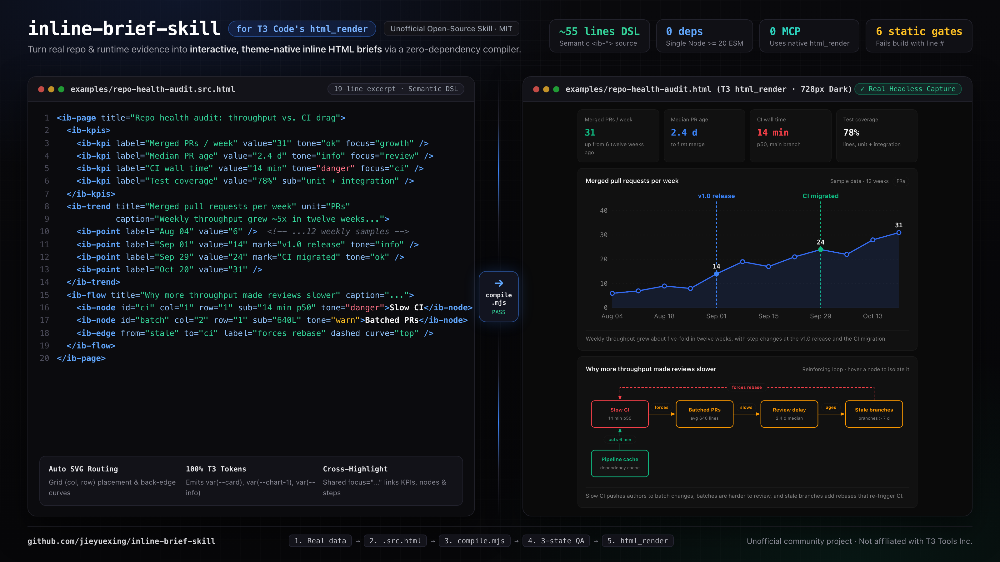
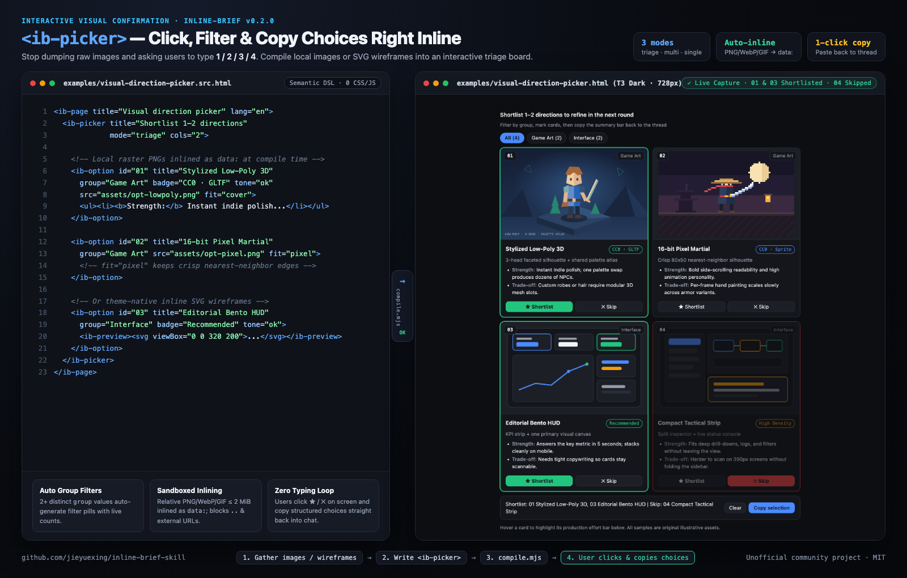
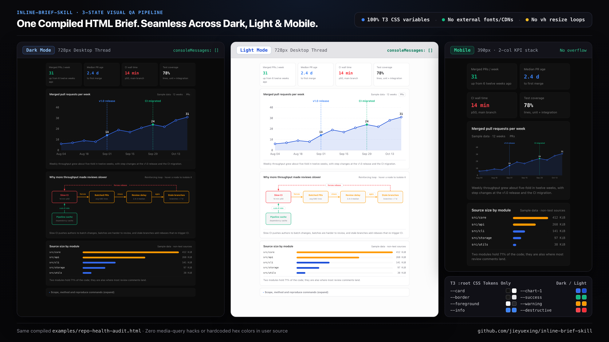
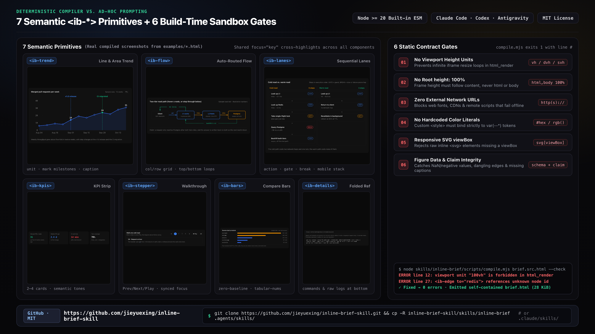

# inline-brief-skill

**Turn evidence into interactive, theme-native visuals that render inline in a T3 Code thread.** An agent skill plus a zero-dependency compiler for T3 Code's native `html_render` pipeline: write ~60 lines of semantic `<ib-*>` tags, get one self-contained HTML page with KPI strips, trend charts, auto-routed flow diagrams, swimlanes, a step-through player, and interactive visual option pickers (`<ib-picker>`), already linted against the sandbox rules that otherwise break inline previews.

> Unofficial community skill built for T3 Code's `html_render`. Not affiliated with or endorsed by T3 Tools Inc.

[中文说明](README.zh-CN.md) · [Skill](skills/inline-brief/SKILL.md) · [Component reference](skills/inline-brief/references/components.md) · [`html_render` contract](skills/inline-brief/references/t3-contract.md)



## Give this to your agent

Paste this into a T3 Code thread (or any agent session with shell access):

```text
Install the inline-brief skill from https://github.com/jieyuexing/inline-brief-skill:
clone it, copy skills/inline-brief into this project's skill directory
(.claude/skills/ for Claude Code, .agents/skills/ for Codex and Antigravity),
read skills/inline-brief/SKILL.md, then use it to explain <your topic> with a
visual brief rendered through html_render.
```

## Why

Raw HTML and SVG written by an LLM for an inline preview tends to fail in the same ways: `100vh` resize loops, hardcoded colors that clash with the theme, web fonts or CDN scripts that never load behind a proxy, hand-calculated SVG coordinates that overlap. `inline-brief` moves all of that into a compiler:

- **Semantic DSL.** The agent writes nodes, edges, points and bars with real data. Styles, SVG routing and interaction code are generated.
- **Static contract gates.** Six classes of `html_render` violations fail the build with a line number (see [below](#static-gates)).
- **Native theming.** Output uses only T3 CSS variables (`--card`, `--border`, `--chart-1`, `--info`, ...), so it follows Dark, Light and custom themes.
- **Zero dependencies.** One Node >= 20 ES module, no install step, no network access, zero external URLs or embeds in the output (`data:` and `#id` allowed).

## Examples





| Page | Components | Source |
| --- | --- | --- |
| [`visual-direction-picker.html`](examples/visual-direction-picker.html) | Interactive `<ib-picker>` triage board (local PNG inlining + theme-native SVG wireframes, category filter pills, ★ Shortlist / ✕ Skip, 1-click copy summary) + linked effort bars | [`.src.html`](examples/visual-direction-picker.src.html) |
| [`cache-read-path.html`](examples/cache-read-path.html) | KPIs, flow with back edges, stepper linked to the flow, Cold vs. Warm swimlanes, latency bars | [`.src.html`](examples/cache-read-path.src.html) |
| [`repo-health-audit.html`](examples/repo-health-audit.html) | KPIs, trend chart with milestone marks, causal-loop flow, module-size bars, folded method | [`.src.html`](examples/repo-health-audit.src.html) |

All figures and artwork in the examples are original illustrative sample data.

## Install

Copy `skills/inline-brief/` into the skill directory your agent reads, or clone and symlink it. Under T3 Code each provider reads its own location:

| Agent (running in T3 Code) | Project scope | User scope |
| --- | --- | --- |
| Claude Code | `.claude/skills/inline-brief/` | `~/.claude/skills/inline-brief/` |
| Codex | `.agents/skills/inline-brief/` | `~/.codex/skills/inline-brief/` (some Codex versions read `~/.agents/skills/`) |
| Antigravity | `.agents/skills/inline-brief/` (legacy `.agent/skills/`) | `~/.gemini/antigravity/skills/inline-brief/` (the CLI also reads `~/.gemini/config/skills/`) |

```bash
git clone https://github.com/jieyuexing/inline-brief-skill.git
mkdir -p .claude/skills && cp -R inline-brief-skill/skills/inline-brief .claude/skills/   # Claude Code
mkdir -p .agents/skills && cp -R inline-brief-skill/skills/inline-brief .agents/skills/   # Codex / Antigravity
```

Claude Code can also install it as a plugin: `/plugin marketplace add jieyuexing/inline-brief-skill`, then `/plugin install inline-brief-skill@inline-brief-skill`. The repository ships an [Agent Plugins 1.0](https://agent-plugins.org) `plugin.json` as well. Skill paths vary by agent version; check your agent's documentation if the skill is not discovered.

## DSL at a glance



```html
<ib-page title="Cache read path" lang="en">
  <ib-kpis>
    <ib-kpi label="p99 latency" value="38 ms" sub="cold reads" tone="warn"></ib-kpi>
  </ib-kpis>

  <ib-trend title="Merged PRs per week" unit="PRs" caption="Throughput stepped up after v1.0.">
    <ib-point label="Aug 04" value="6" />
    <ib-point label="Sep 01" value="14" mark="v1.0 release" tone="info" />
    <ib-point label="Oct 20" value="31" />
  </ib-trend>

  <ib-flow title="Read path" caption="Postgres is reached only after both tiers miss.">
    <ib-node id="l1" col="1" row="1" sub="in-process">L1 cache</ib-node>
    <ib-node id="db" col="2" row="1" tone="warn">Postgres</ib-node>
    <ib-edge from="l1" to="db" label="miss" tone="warn"></ib-edge>
  </ib-flow>
</ib-page>
```

| Tag | Purpose |
| --- | --- |
| `<ib-kpis>` / `<ib-kpi>` | telemetry strip, 2-4 cards |
| `<ib-trend>` / `<ib-point>` | line and area trend chart, axes, value labels, `mark` milestone lines |
| `<ib-bars>` / `<ib-bar>` | zero-baseline comparison bars with units |
| `<ib-flow>` / `<ib-node>` / `<ib-edge>` | grid-placed, auto-routed diagram with labeled and back edges |
| `<ib-lanes>` / `<ib-lane>` / `<ib-step>` | sequential swimlanes with `action`, `gate`, `break` steps |
| `<ib-stepper>` / `<ib-stage>` | step-through player that highlights elements by `focus` key |
| `<ib-picker>` / `<ib-option>` / `<ib-preview>` | interactive visual confirmation board (`triage` / `multi` / `single`), auto group filters, safe local image inlining, 1-click copyable selection summary |
| `<ib-grid>`, `<ib-details>` | two-column wrapper, folded reference block |

Full attribute reference: [`components.md`](skills/inline-brief/references/components.md).

## Static gates

`compile.mjs` exits non-zero and prints `ERROR line N: ...` for:

1. `vh` / `dvh` / `svh` / `lvh` units in CSS (`<style>` and `style=`)
2. `height: 100%` on `html`, `body`, or `:root` selectors
3. external URLs (`http(s)://` or `//`) in URL attributes (`src`, `href`, `srcset`, `poster`, `data`, `action`, `formaction`, `xlink:href`, quoted or unquoted), CSS `@import` / `url()` (`<style>` and `style=`), `<iframe>`/`<object>`/`<embed>`, or `<script>` (`fetch(`, `XMLHttpRequest`, `import(`, external URL strings); `data:` URIs and `#id` anchors are allowed (enforced as self-contained skill policy; the T3 host itself permits remote URLs)
4. hardcoded colors (`#hex`, `rgb()`, `hsl()`, `oklch()`, named colors) in CSS declarations (`<style>`, `style=`) or SVG `fill`/`stroke`/`stop-color`
5. a raw `<svg>` without `viewBox`
6. invalid DSL structure or figure data: unknown/misplaced `<ib-*>` tags, content outside `<ib-page>`, empty/non-numeric values, `max` below peak, unknown `tone`/`kind`/`curve`, flow cell collisions or column overflow, empty `<ib-lane>`, dangling edges, duplicate node ids, missing `caption` on a flow or trend, fewer than two trend points

It also warns about edge labels wider than their gap, overlapping trend marks, and dangling `focus` keys.

## Use and verify locally

```bash
# compile (writes examples/cache-read-path.html next to the source by default)
node skills/inline-brief/scripts/compile.mjs examples/cache-read-path.src.html

# lint only, no output file
node skills/inline-brief/scripts/compile.mjs examples/cache-read-path.src.html --check

# tests (Node >= 20, no install)
node --test test/*.test.mjs
```

In T3 Code the agent then runs `html_preview` three times (dark 728px, light 728px, dark 390px), checks that `consoleMessages` is empty, and calls `html_render` with the compiled file. See [`SKILL.md`](skills/inline-brief/SKILL.md).

## License

[MIT](LICENSE)
