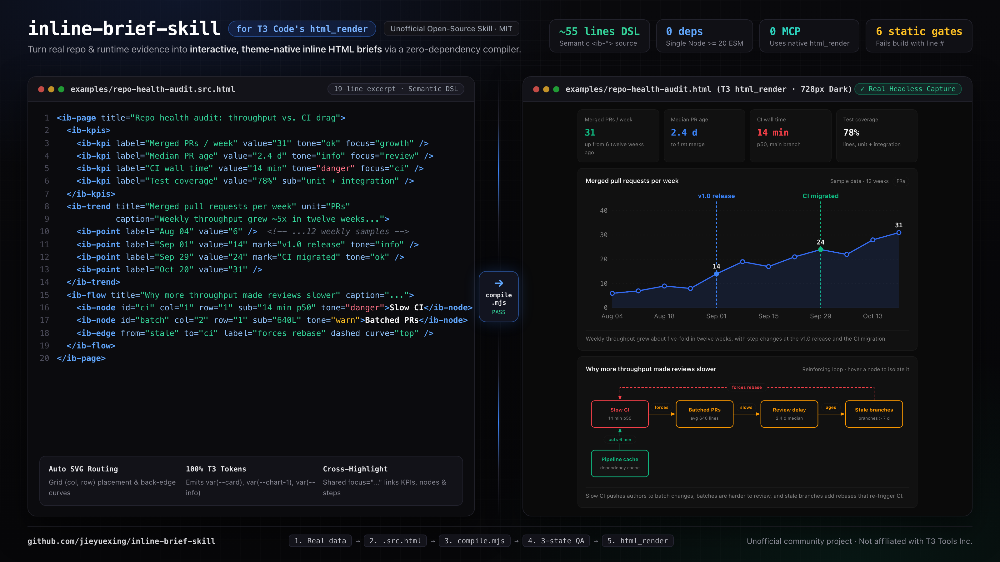
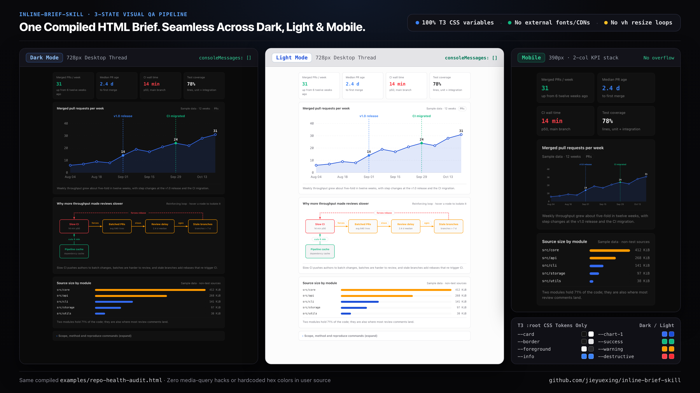
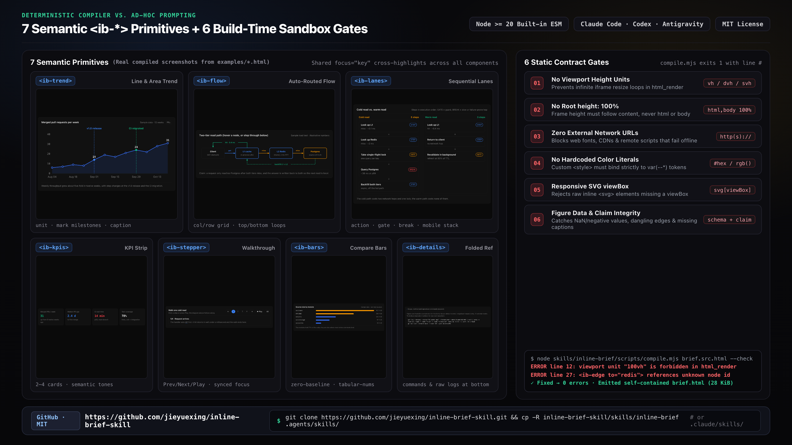

# inline-brief-skill

**把证据变成能在 T3 Code 对话里原生内联渲染、自动跟随主题的交互式图文。** 这是一个面向 T3 Code `html_render` 管线的 Agent Skill，附带零依赖编译器：只需写约 60 行语义化 `<ib-*>` 标签，就能得到一个自包含 HTML，包含 KPI 条、折线趋势图、自动布线流程图、泳道对比和分步播放器，并且已通过沙箱合同静态校验。

> Unofficial community skill built for T3 Code's `html_render`. Not affiliated with or endorsed by T3 Tools Inc.
> （非官方社区 Skill，与 T3 Tools Inc. 无隶属或背书关系。）

[English](README.md) · [Skill](skills/inline-brief/SKILL.md) · [组件参考](skills/inline-brief/references/components.md) · [`html_render` 合同](skills/inline-brief/references/t3-contract.md)



## 直接交给你的 Agent

把下面这段贴进 T3 Code 对话（或任何能执行 shell 的 Agent 会话）：

```text
请从 https://github.com/jieyuexing/inline-brief-skill 安装 inline-brief skill：
克隆仓库，把 skills/inline-brief 复制到当前项目的 skill 目录
（Claude Code 用 .claude/skills/，Codex 与 Antigravity 用 .agents/skills/），
读完 skills/inline-brief/SKILL.md 后，用它为「<你的主题>」生成一张
通过 html_render 渲染的图文讲解。
```

## 为什么需要它

让大模型直接手写内联预览用的 HTML/SVG，常见翻车点相同：`100vh` 触发 iframe 反复缩放、写死色值与主题冲突、网页字体或 CDN 脚本在代理环境下加载失败、手算 SVG 坐标导致重叠。`inline-brief` 把这些都下沉到编译器：

- **语义 DSL**：Agent 只写节点、连线、数据点、柱条与真实数据，样式、SVG 布线与交互脚本由编译器生成。
- **静态合同门禁**：六类 `html_render` 违规会带行号直接编译失败（见 [静态门禁](#静态门禁)）。
- **原生主题**：产物只使用 T3 的 CSS 变量（`--card`、`--border`、`--chart-1`、`--info` 等），亮色、暗色与自定义主题自动同步。
- **零依赖**：单个 Node >= 20 ES 模块，无需安装，无需联网，产物不含任何外链或外部嵌入（仅放行 `data:` 与页内 `#id`）。

## 示例



| 页面 | 组件 | 源码 |
| --- | --- | --- |
| [`cache-read-path.html`](examples/cache-read-path.html) | KPI、带回退连线的流程图、与流程图联动的步进器、冷/热读泳道、延迟柱图 | [`.src.html`](examples/cache-read-path.src.html) |
| [`repo-health-audit.html`](examples/repo-health-audit.html) | KPI、带里程碑标注的趋势图、因果闭环流程图、模块体量柱图、折叠的方法说明 | [`.src.html`](examples/repo-health-audit.src.html) |

示例中的全部数字均为演示用样例数据。

## 安装

把 `skills/inline-brief/` 复制到你的 Agent 读取的 skill 目录，或克隆后建立软链接。在 T3 Code 下各提供方读取各自目录：

| Agent（在 T3 Code 中运行） | 项目级 | 用户级 |
| --- | --- | --- |
| Claude Code | `.claude/skills/inline-brief/` | `~/.claude/skills/inline-brief/` |
| Codex | `.agents/skills/inline-brief/` | `~/.codex/skills/inline-brief/`（部分版本读 `~/.agents/skills/`） |
| Antigravity | `.agents/skills/inline-brief/`（旧版 `.agent/skills/`） | `~/.gemini/antigravity/skills/inline-brief/`（CLI 另读 `~/.gemini/config/skills/`） |

```bash
git clone https://github.com/jieyuexing/inline-brief-skill.git
mkdir -p .claude/skills && cp -R inline-brief-skill/skills/inline-brief .claude/skills/   # Claude Code
mkdir -p .agents/skills && cp -R inline-brief-skill/skills/inline-brief .agents/skills/   # Codex / Antigravity
```

Claude Code 也可作为插件安装：`/plugin marketplace add jieyuexing/inline-brief-skill`，再 `/plugin install inline-brief-skill@inline-brief-skill`。仓库同时带有 [Agent Plugins 1.0](https://agent-plugins.org) 的 `plugin.json`。各 Agent 版本的 skill 路径可能变化，若未被发现请查阅对应文档。

## DSL 速览



| 标签 | 用途 |
| --- | --- |
| `<ib-kpis>` / `<ib-kpi>` | 指标条，2 到 4 张卡片 |
| `<ib-trend>` / `<ib-point>` | 折线面积趋势图，含坐标轴、数值标注与 `mark` 里程碑虚线 |
| `<ib-bars>` / `<ib-bar>` | 零基线对比柱条，支持单位 |
| `<ib-flow>` / `<ib-node>` / `<ib-edge>` | 网格定位、自动布线的流程图，支持带标签连线与回退连线 |
| `<ib-lanes>` / `<ib-lane>` / `<ib-step>` | 顺序泳道，步骤类型 `action`、`gate`、`break` |
| `<ib-stepper>` / `<ib-stage>` | 分步播放器，按 `focus` 键联动高亮 |
| `<ib-grid>`、`<ib-details>` | 双栏容器、折叠参考块 |

`<ib-trend>` 示例：

```html
<ib-trend title="每周合并 PR" unit="PRs" caption="v1.0 发布后吞吐明显抬升。">
  <ib-point label="08-04" value="6" />
  <ib-point label="09-01" value="14" mark="v1.0 发布" tone="info" />
  <ib-point label="10-20" value="31" />
</ib-trend>
```

完整属性见 [`components.md`](skills/inline-brief/references/components.md)。

## 静态门禁

`compile.mjs` 遇到以下情况会输出 `ERROR line N: ...` 并以非零码退出：

1. CSS 上下文（`<style>` 与 `style=`）中的 `vh` / `dvh` / `svh` / `lvh` 单位
2. 作用于 `html`、`body` 或 `:root` 选择器的 `height: 100%`
3. 零外链（Skill 自加的离线/代理安全规定，宿主自身允许远程 URL）：URL 属性（`src`、`href`、`srcset`、`poster`、`data`、`action`、`formaction`、`xlink:href`，含无引号）中的 `http(s)://` 或 `//`，CSS `@import` / `url()`（含行内 `style=`），`<iframe>`/`<object>`/`<embed>`，以及 `<script>` 中的 `fetch(`、`XMLHttpRequest`、`import(` 和字符串外链（`data:` 与 `#id` 放行）
4. `<style>`、行内 `style=` 或 SVG `fill`/`stroke`/`stop-color` 中写死的色值（`#hex`、`rgb()`、`hsl()`、`oklch()`、命名色）
5. 缺少 `viewBox` 的原生 `<svg>`
6. 非法 DSL 结构与图表数据：未知或错位 `<ib-*>` 标签、`<ib-page>` 外非空内容、空值/非数字、`max` 小于最大值、未知 `tone`/`kind`/`curve`、流程图同格碰撞或列数溢出、空 `<ib-lane>`、悬空连线、重复节点 id、流程图或趋势图缺少 `caption`、趋势点少于 2 个

连线标签超出间距、趋势图里程碑文字可能重叠、悬空 `focus` 键时给出警告。

## 本地使用与验证

```bash
# 编译（默认在源文件旁写出 .html）
node skills/inline-brief/scripts/compile.mjs examples/cache-read-path.src.html

# 只校验，不写文件
node skills/inline-brief/scripts/compile.mjs examples/cache-read-path.src.html --check

# 测试（Node >= 20，无需安装依赖）
node --test test/*.test.mjs
```

在 T3 Code 中，Agent 随后用 `html_preview` 做三态预览（暗色 728px、亮色 728px、暗色 390px），确认 `consoleMessages` 为空，再用编译产物调用 `html_render`。详见 [`SKILL.md`](skills/inline-brief/SKILL.md)。

## 许可证

[MIT](LICENSE)
